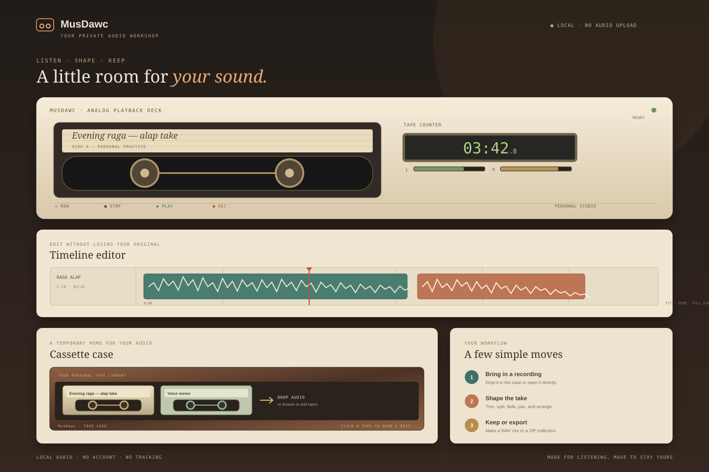

# MusDawc

MusDawc is a basic, browser-based audio editing tool built for personal use. It helps you listen to, shape, and organize recordings on your own device. The `.musdawc` project format is reserved for local project portability; project-container import/export is not implemented yet.

## How it works



This illustrated overview shows the basic flow: bring in a recording, edit it on the timeline, then export a WAV mix or keep the original in a temporary cassette collection.

## Run locally

Requires Node.js 20.19 or newer and npm.

```sh
npm install
npm run dev
```

The editor imports WAV, MP3, OGG, FLAC and M4A when the browser decoder supports the format, records microphone takes, and supports clip arrangement, split, trim, duplicate, reverse, undo/redo, timeline zoom and fullscreen. Per-take controls include gain, fades, pan, mute and solo. Sessions autosave to local IndexedDB with a recovery prompt. Export renders a 24-bit stereo WAV. The temporary Cassette Case accepts audio by drag and drop, organizes selected tapes into named folders, and downloads each folder as a ZIP. Cassette Case contents live only in memory and clear on reload; ZIP export is limited to 200 MB per folder. All audio stays in the browser.

## Security and privacy

The browser validates file signatures and enforces 200 MB/file, 60 minute, 192 kHz and 8 channel limits before accepting a decoded buffer. Microphone permission is requested only after pressing REC. See [docs/SECURITY.md](docs/SECURITY.md) and [PRIVACY.md](PRIVACY.md) for implementation limits and the threat model.

The project has no backend. No claim can guarantee safety against every threat: browser decoder vulnerabilities, compromised build tools and host compromise remain relevant risks. Use current browsers and review dependency updates before release.

## Status

MusDawc is a personal-use audio editor, not a full DAW. Current limitations and implementation decisions are tracked in [docs/DECISIONS.md](docs/DECISIONS.md).

## License

The project code is licensed under the MIT License; see [LICENSE](LICENSE). This permits others to use, modify, and redistribute the code subject to its notice conditions. It does not grant rights to audio recordings used with the app. See [THIRD_PARTY_LICENSES.md](THIRD_PARTY_LICENSES.md) for the direct runtime dependency licenses.
